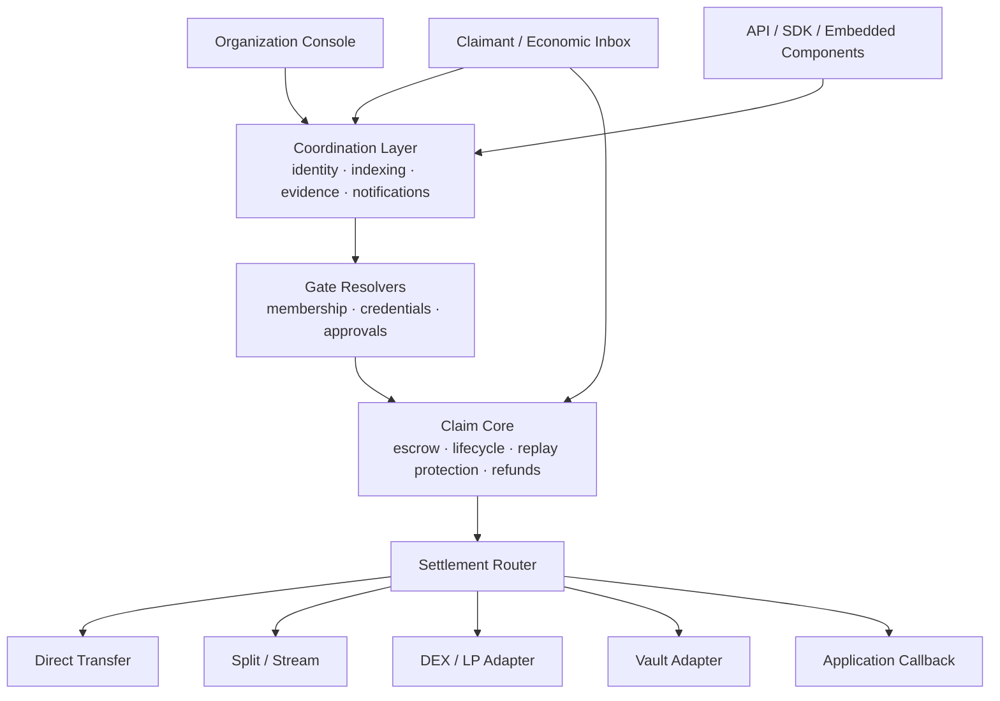

# Product Thesis and High-Level Architecture

## Document purpose

This document captures the proposed evolution of GiftLink from a USDC gifting MVP into a broader Web3 product and protocol. It is an internal strategy and architecture reference. It explains the core product idea, the people it serves, how the system could work, what must remain on-chain or off-chain, and a realistic path from the current codebase.

This document intentionally avoids choosing a new product name.

## Executive thesis

Blockchains are good at transferring value between known addresses. Most economic relationships, however, do not begin with two known wallet addresses. They begin with people, identities, memberships, achievements, agreements, purchases, milestones, and obligations.

The proposed product introduces a generalized object called a **Claim**:

> A Claim is funded value addressed to a person, group, condition, or machine before the final receiving wallet or settlement action is known.

Every Claim answers three questions:

1. **Who** is entitled to access the value?
2. **When** does the value become available?
3. **What** happens when the Claim is settled?

A Claim has one defining property: its value is already funded. It is not an invoice, promise, points balance, or speculative notification. The capital is escrowed and verifiable.

The consumer-facing expression of this protocol is an **economic inbox**: one place where a person or machine can discover value, rights, rewards, refunds, grants, and funded actions available to them across applications.

The original GiftLink experience becomes the simplest Claim configuration:

```text
Capital:       50 USDC
Gate:          One verified recipient
Availability:  Before a seven-day expiry
Settlement:    Transfer USDC
Presentation:  A shareable envelope
```

Gifts, protocol incentives, refunds, grants, bounties, recurring allocations, and agent payments are different configurations of the same primitive rather than separate product lines.

## The core insight: value needs addressing

A conventional blockchain transaction says:

```text
Send 100 USDC from wallet A to wallet B.
```

A Claim can say:

```text
Reserve 100 USDC for the person who satisfies these conditions,
then perform an approved action when that person arrives.
```

This enables an application to owe someone value before knowing their wallet. The claimant may later prove control of an email address, social account, application account, credential, wallet, or private membership proof. At settlement, the entitlement is bound to the claimant's chosen wallet.

This fills a gap between identity systems and blockchains:

```text
Human identity or application state
                ↓
          Funded Claim
                ↓
      Eligibility is proven
                ↓
    An approved outcome settles
                ↓
       On-chain value movement
```

DEXes make assets exchangeable. Claims make value addressable.

## Product model

The product is a two-sided network with three interfaces.

### Claimant experience

Individuals and machines use the economic inbox to see Claims that they can access, Claims that will become available later, and Claims that require an action or proof.

The claimant should not need prior crypto knowledge, a pre-existing wallet, or gas. Authentication can create or connect the required wallet in the background. The experience should emphasize the value, issuer, conditions, risks, and available settlement choices.

### Organization experience

Organizations, protocols, communities, merchants, grant programs, and individual funders use a console to create and manage Claim programs. They configure budgets, eligibility, availability, settlement choices, expiry, refunds, reviewers, and notifications without writing smart contracts.

### Developer experience

Developers integrate Claims through an API, TypeScript SDK, webhooks, embeddable claim components, and optional smart-contract interfaces. They can issue Claims inside their own products, contribute verification integrations, or connect settlement destinations.

These are not separate systems. They are interfaces over the same Claim lifecycle.

## Minimal vocabulary

The system should use a small, stable set of concepts.

### Claim

A funded, gated, settleable obligation. It is the primary unit of the protocol.

### Gate

A policy defining who may settle the Claim and when. Identity eligibility and release conditions are both parts of the Gate.

### Attestation

A signed statement from a named source about an identity or event. Examples include “this account has the contributor role,” “this customer purchased product X,” or “reviewers approved milestone 3.”

### Settlement

The approved outcome executed when the Gate is satisfied. Examples include a direct transfer, split, swap, stream, vault deposit, LP position, mint, or application callback.

### Inbox

The claimant-facing view of relevant Claims. The inbox is indexed by the identities and credentials a claimant chooses to connect.

## Claim lifecycle

The base lifecycle should remain deliberately small:

```text
Draft → Funded and available → Settled
                         └──→ Expired → Reclaimed
```

Long-lived Claims may release multiple tranches, but every tranche must have unambiguous funding, eligibility, settlement, and recovery rules.

## High-level architecture



### Claim Core

The Claim Core is the small, conservative smart-contract layer responsible for:

- Escrowing assets.
- Recording the Claim state.
- Committing to the Gate and settlement configuration.
- Preventing repeated settlement.
- Enforcing opening and expiry times.
- Returning unused funds according to predefined rules.
- Authorizing and paying relayers or solvers.
- Emitting canonical lifecycle events.

The core should not contain DEX-specific, Discord-specific, grant-specific, or application-specific logic.

A conceptual Claim structure is:

```solidity
struct Claim {
    address issuer;
    address asset;
    uint256 remainingBudget;
    uint256 amountPerSettlement;
    bytes32 gateHash;
    address gateVerifier;
    address settlementAdapter;
    bytes32 settlementConfigHash;
    uint64 opensAt;
    uint64 expiresAt;
    uint32 maximumSettlements;
    ClaimStatus status;
}
```

An individual Claim and a large campaign can use the same model. An individual Claim has one settlement. A campaign holds a larger budget, sets an amount or allocation rule, and permits multiple eligible claimants.

### Gate resolvers and verifiers

A Gate is structured policy data, not arbitrary prose. Organizations compose Gates from supported modules. The final policy is hashed and committed with the Claim, preventing silent rule changes after funding.

There are three broad Gate models.

#### On-chain Gates

These can be verified directly by a contract:

- Wallet ownership.
- Merkle allowlist membership.
- Token or NFT ownership.
- Historical activity at a pinned block.
- Time conditions.
- Governance outcomes.
- Other contract state.
- Valid cryptographic proofs.

#### Attested Gates

These depend on a named source:

- Email or social account ownership.
- Discord roles.
- GitHub contribution status.
- Customer purchase history.
- Event attendance.
- Manual milestone approval.
- Off-chain application activity.

A Resolver checks the source and signs an Attestation. The Claim identifies which Resolver is trusted for that fact. The contract verifies the signed authorization or attestation.

#### Composite Gates

Supported Gates can be composed:

```text
Community contributor
AND wallet held membership asset at snapshot
AND has not claimed before
AND claim occurs before expiry
```

The platform must disclose the assurance of each Gate. “Verified on-chain,” “attested by a named organization,” and “approved by the issuer” are different guarantees.

### Settlement Router

The Settlement Router sends Claim funds into reviewed adapters. Each adapter performs one constrained class of action.

A conceptual adapter interface is:

```solidity
interface ISettlementAdapter {
    function settle(
        address asset,
        uint256 amount,
        address claimant,
        bytes calldata configuration
    ) external returns (SettlementResult memory);
}
```

Initial adapters should include:

- Direct asset transfer.
- Fixed split.
- Basic stream or tranche release.
- Simple DEX swap.

Later adapters may include:

- Constant-product LP positions.
- Vault deposits.
- Bridges.
- Application callbacks.
- Claim creation for subsequent obligations.

Adapters must be reviewed and allowlisted initially. They must not accept arbitrary execution targets, use unrestricted delegate calls, or access unrelated Claim balances. Settlement parameters must be committed or bound into the claimant authorization.

### Coordination layer

Some work belongs off-chain:

- OAuth and social identity verification.
- Private identity-to-wallet binding.
- Attestation retrieval and storage.
- Economic inbox indexing.
- Notification delivery.
- Evidence submission and human review.
- Gas estimation and relayer coordination.
- Organization configuration and permissions.
- Analytics and webhook delivery.
- Chain event reconciliation.

The blockchain remains authoritative for funding and settlement. The database is an index and workflow store, not the ledger of record.

## Trust model

The architecture must separate two kinds of trust.

### Custody trust

This answers: “Is the money really there, and can an administrator take it?”

The target design should make custody trust-minimized:

- Claims are fully funded.
- Active escrow cannot be swept by an administrator.
- Claims cannot settle twice.
- Refund rules are fixed before funding.
- Adapters can only use the amount assigned to one settlement.
- Pausing prevents new execution without confiscating funds.
- On-chain events are authoritative.

The current GiftLink contract does not yet satisfy these requirements and must be redesigned before supporting significant value.

### Gate trust

This answers: “Who says that the claimant qualifies?”

The answer depends on the condition:

| Gate | Trust model |
|---|---|
| Wallet signature | Cryptographic verification |
| On-chain ownership | Smart-contract verification |
| Merkle snapshot | Committed snapshot methodology |
| Discord membership | Discord plus declared Resolver |
| Purchase history | Merchant or commerce platform |
| Milestone approval | Named reviewer threshold |
| Subjective work quality | Named humans and dispute policy |

The system cannot make a subjective real-world fact trustless. It can make the funding verifiable, identify who is trusted, record decisions, require thresholds, add challenge periods, and enforce the resulting decision consistently.

## Economic inbox experience

The inbox shows funded possibilities addressed to the claimant.

Suggested sections include:

### Available now

- Direct transfers.
- Protocol rewards.
- Refunds.
- Approved grant tranches.

### Unlockable

- Claims requiring identity verification.
- Claims requiring an action or submission.
- Milestones awaiting evidence or approval.

### Scheduled

- Future tranches.
- Recurring allocations.
- Time-locked Claims.

### Completed

- Settled Claims and receipts.
- Expired Claims.
- Rejected or disputed Claims with reasons.

The inbox should never become a generic advertising feed. Every visible item must represent verifiably funded value.

This creates a natural anti-spam property: placing value in an inbox costs the issuer real capital. Additional protections should include issuer reputation, claimant blocklists, notification controls, value and relevance ranking, and stricter rules for unknown issuers.

## Organization configuration

Organizations use a program builder rather than Solidity.

### Define funding

```text
Asset:             USDC
Budget:            50,000
Funding wallet:    Organization multisig
Expiry:            30 days
Unused funds:      Return to treasury
```

### Define the Gate

Options may include:

- One person.
- Wallet allowlist or CSV.
- Token-holder snapshot.
- Discord role.
- GitHub contribution.
- Existing customer cohort.
- Named reviewer approval.
- Composite policy.

### Define availability

- Immediately.
- At a future date.
- After an Attestation.
- Per milestone.
- First N eligible claimants.
- Until the program budget is exhausted.

### Define settlement

- Direct transfer.
- Claimant choice among approved assets or outcomes.
- Split.
- Stream.
- Swap.
- LP position.
- Vault deposit.
- Application callback.

### Fund and publish

The console validates the configuration, hashes the Gate and settlement policy, simulates transactions, calculates funding and fees, requests treasury approval, waits for on-chain confirmation, and produces claim links, embedded components, API identifiers, and webhooks.

The SDK exposes the same process through typed configuration:

```ts
await claims.create({
  asset: USDC,
  budget: "50000",
  gate: all(
    discordRole("community-id", "contributor"),
    uniqueClaimant()
  ),
  settlement: claimantChoice([
    directTransfer(),
    lpPosition({
      venue: "approved-dex",
      pair: "USDC/TOKEN",
      maxPriceImpact: 0.5
    })
  ]),
  expiry: "2026-10-31"
});
```

This is structured configuration. A new external fact source requires a Resolver integration. A new financial venue requires a reviewed Settlement Adapter. A new trustless predicate requires a verifier contract.

## End-to-end examples

### Verified community campaign

An organization creates a 50,000 USDC campaign for 1,000 verified contributors.

1. It defines membership as a Discord contributor role plus ownership of a membership asset at a snapshot block.
2. The snapshot is committed using a Merkle root.
3. The organization selects a trusted Discord Resolver.
4. It funds the campaign from its treasury.
5. A claimant authenticates Discord and connects or creates a wallet.
6. The Resolver verifies the role and produces an Attestation.
7. The claimant supplies the Attestation and Merkle proof.
8. The protocol checks the Gate and a nullifier prevents a second claim.
9. The Claim settles to an approved outcome.
10. The organization receives a webhook and the inbox shows a receipt.

The platform does not independently know who belongs to the community. It enforces the community's declared definition and evidence sources.

### Guided LP position

An issuer offers 100 USDC that may be claimed into an approved USDC/token pool.

1. The issuer selects a reviewed LP destination preset.
2. The preset defines the DEX, pair, split, maximum price impact, minimum output, deadline, and recipient.
3. The claim page explains that the claimant will receive an LP position and discloses the risks.
4. The claimant explicitly chooses or accepts that settlement.
5. The chosen parameters are included in the authorization.
6. The Claim Core transfers funds to the LP Adapter.
7. The adapter swaps the required portion and supplies both assets to the pool.
8. The LP token or position is delivered directly to the claimant.
9. If minimum-output or price-impact limits fail, the entire transaction reverts and the Claim remains available.

A simple constant-product LP adapter is feasible on an EVM chain if a sufficiently liquid Arc venue exists. Concentrated liquidity requires range selection, NFT position handling, and ongoing management, so it belongs later.

### Milestone grant

An organization funds a 24,000 USDC grant across six milestones.

1. It selects the grantee, milestones, amounts, reviewers, approval threshold, deadlines, and dispute policy.
2. The entire grant budget is deposited into a program escrow.
3. The grantee sees the schedule and next requirement in the inbox.
4. The grantee submits evidence for a milestone.
5. Two of three reviewers approve it.
6. Their signed approvals satisfy the milestone Gate.
7. The associated tranche becomes available.
8. The grantee settles it using an approved outcome.
9. Unapproved funds follow the program's expiry and return rules.

Objective milestones can use contract state or oracles. Subjective milestones require named reviewers. A later version may add bonds, challenge windows, and arbitration, but subjective judgment must never be presented as automatic truth.

## Relationship with DEXes and dApps

The protocol should complement existing infrastructure:

- Wallets provide custody.
- Identity providers supply account verification.
- Resolvers supply attestations.
- DEXes provide liquidity.
- Bridges provide cross-chain movement.
- Vaults provide financial strategies.
- The Claim network supplies funded demand, eligibility, and settlement coordination.

A DEX can issue Claims to onboard liquidity providers. A game can issue Claims for tournament rewards. A marketplace can issue refunds. A DAO can fund grant tranches. Each can render Claims inside its own interface while the claimant also sees them in the economic inbox.

The network flywheel is:

1. Issuers bring funded value.
2. Funded value attracts claimants and settlement operators.
3. Better settlement routes improve the claimant experience.
4. More claimants make identity and eligibility integrations more useful.
5. Better eligibility reduces fraud and makes larger programs viable.
6. Larger programs attract more issuers, Resolvers, and settlement venues.

The defensible assets are the resolvable identity-and-state graph, settlement flow, integration standard, issuer reputation, and distribution across claimant inboxes. The escrow contract alone is not a moat.

## Business model

Revenue should align with successful settlement.

- A small protocol fee on settled value.
- A protocol share of solver or relayer fees.
- Routing fees on paid Attestations.
- Organization subscriptions for program management, permissions, reporting, analytics, private programs, and service guarantees.
- Integration or revenue-sharing agreements with settlement venues.

The claimant side should remain free for normal use. The inbox should not contain advertising, and claimant identity data should not be sold.

A protocol token is not required for the initial system. It should only be considered if an active permissionless Resolver or solver network needs cryptoeconomic security that cannot be achieved through existing assets, bonds, or reputation.

## Feasibility

### Feasible with established EVM patterns

- Individual and campaign Claims.
- Fully funded USDC escrow.
- Wallet, Merkle, token ownership, and time Gates.
- Email and social Gates through signed Attestations.
- Reviewer-approved milestones.
- Organization programs and multisig funding.
- Direct, split, and basic swap settlement.
- Simple LP settlement when a suitable venue exists.
- Gas sponsorship.
- API, SDK, webhooks, and embedded claim interfaces.
- An indexed economic inbox.

### Later or research-heavy

- Privacy-preserving membership and identity proofs.
- Open Resolver markets with staking and slashing.
- Permissionless adapter registration.
- Concentrated liquidity management.
- Cross-chain Claims and cross-chain LP settlement.
- General dispute and arbitration markets.
- Transferable Claims or Claim-backed lending.
- Fully autonomous agent commerce.

## Security and recovery requirements

Before the protocol holds meaningful value, it must provide:

- No administrator sweep of active Claims.
- Strongly bound EIP-712 authorizations including chain, contract, claimant, Gate, settlement, nonce, amount, and expiry.
- Per-Claim replay protection.
- Idempotent relay execution.
- Multiple relayers or permissionless settlement.
- Hardware-backed or threshold authorization keys during centralized stages.
- Event-driven reconciliation for creation, settlement, revocation, expiry, and refunds.
- Action-aware gas estimation.
- RPC failover and stuck-transaction recovery.
- Adapter allowlisting, simulations, limits, and audits.
- Defined refund and dispute behaviour for every Claim.
- Per-Claim salts and careful handling of private identity data.
- Emergency pausing that cannot confiscate funds.

## Staged implementation path

### Phase 0: Repair the existing primitive

- Redesign the contract around non-custodial Claim escrow.
- Fix identifiers, authorization binding, expiry, refunds, and relaying.
- Make chain events authoritative.
- Remove dangerous administrative withdrawal powers.
- Build meaningful tests for every money and authorization path.
- Complete an external contract review before significant mainnet use.

### Phase 1: Claims and the economic inbox

- Introduce the generalized Claim data model.
- Replace the fixed recipient commitment with a Gate commitment.
- Build individual and campaign Claims.
- Support wallet, Merkle, token, email, social, and time Gates.
- Ship direct and split settlement.
- Make the inbox the primary claimant experience.
- Build organization programs, reporting, webhooks, and treasury funding.

Success condition: an unaffiliated application can issue Claims to its users without deploying its own distribution contract.

### Phase 2: Open verification and settlement modules

- Publish Gate verifier and Settlement Adapter interfaces.
- Add a Resolver registry with visible assurance levels.
- Add simple swap settlement.
- Enable independent relayers or solvers.
- Add cohort limits, nullifiers, first-N rules, and tiered allocations.
- Release the TypeScript SDK and embedded claim component.

Success condition: one external Resolver can establish eligibility and another independent operator can settle the Claim correctly.

### Phase 3: Long-lived programs

- Milestone grant escrow.
- Reviewer thresholds.
- Streams, vesting, recurring Claims, and tranches.
- Simple LP and vault adapters.
- Challenge periods for attested conditions.
- Initial private membership proofs.

Success condition: a funded Claim remains active and useful for months without requiring manual payment operations from the issuer.

### Phase 4: Network expansion

- Native Claim rendering in wallets and dApps.
- Cross-chain settlement.
- Machine-readable economic inboxes.
- Agent-issued and agent-settled Claims.
- Resolver and solver specialization.
- Portable private eligibility.

## Scope discipline

The product should not become:

- A generic wallet.
- A conventional payment-management dashboard.
- An airdrop platform.
- A public reward feed.
- A built-in DEX competing for liquidity.
- A yield product using idle escrow.
- A custom appchain without demonstrated necessity.
- A collection of arbitrary execution plugins.
- A token-first ecosystem.

Every major capability must improve at least one of four areas:

```text
Funding
Gates
Settlement
Inbox
```

## Final product statement

> The product is a protocol for funded Claims and an economic inbox where people and machines discover value they are entitled to receive, unlock, or execute.
>
> Issuers reserve value for identities and conditions rather than requiring known wallet addresses. Claimants prove eligibility through transparent Gates and choose or accept a clearly disclosed settlement outcome. The protocol coordinates settlement across wallets, DEXes, bridges, vaults, and applications while keeping funding and recovery rules verifiable.

The envelope is the experience people touch. The Claim is the primitive developers integrate. The economic inbox is the network people return to.
