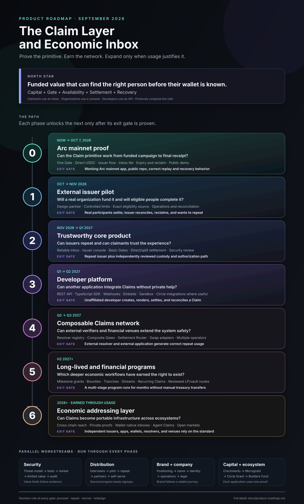
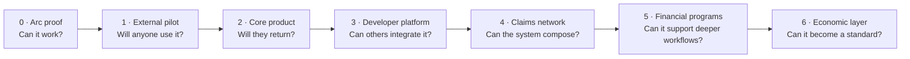
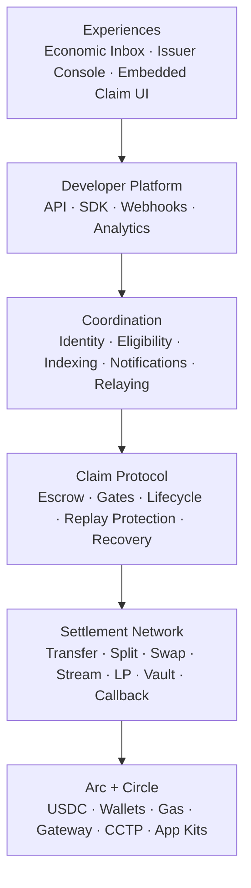

# Product Roadmap: Claim Layer and Economic Inbox

**Status:** Product direction and sequencing reference  
**Created:** September 19, 2026  
**Current release authority:** `docs/build-brief-v1.md`



## How to read this roadmap

This roadmap describes how the current GiftLink MVP can grow into a Claim protocol and economic inbox without attempting to build the entire network at once.

Dates are directional planning windows. **Exit gates control progression.** A later phase begins when the previous phase has produced the required evidence, not merely when a date arrives.

The sequence is:



## North star

The product is a **Claim Layer** with an **economic inbox**.

> A Claim is funded value addressed to a person, group, condition, or machine before the final receiving wallet or settlement action is known.

Every Claim defines:

1. **Capital:** What value has already been funded?
2. **Gate:** Who qualifies, and under what conditions?
3. **Availability:** When can it be accessed?
4. **Settlement:** What approved outcome happens when it is claimed?
5. **Recovery:** What happens to unused value?

The product eventually has four connected surfaces:

| Surface | Primary user | Job |
|---|---|---|
| Economic inbox | Claimants | Discover, understand, unlock, settle, and track funded value |
| Issuer console | Organizations | Create, fund, manage, reconcile, and repeat Claim programs |
| Developer platform | Applications and protocols | Issue and render Claims through APIs, SDKs, webhooks, and components |
| Protocol layer | Resolvers, solvers, wallets, and financial venues | Verify conditions and execute constrained settlement routes |

## Product layers



Each phase strengthens one or more layers. V1 does not need every layer to be open or permissionless.

## Roadmap at a glance

| Phase | Directional window | Main question | Product delivered | Exit gate |
|---|---|---|---|---|
| 0. Arc proof | Sep–Oct 2026 | Can the primitive work end to end? | One funded community campaign, one Gate, direct USDC, inbox lite | Working Arc mainnet proof, public repo, full demo |
| 1. External pilot | Oct–Nov 2026 | Will a real issuer use it? | Controlled program with a design partner | Real participants settle; issuer can reconcile and reclaim |
| 2. Core product | Nov 2026–Q1 2027 | Will issuers repeat and users trust it? | Reliable inbox, issuer console, several basic Gates, hardened Claim Core | Repeat issuer and independently reviewed custody path |
| 3. Developer platform | Q1–Q2 2027 | Can another product integrate without us? | Versioned API, TypeScript SDK, webhooks, embeds, sandbox | Unaffiliated developer completes an integration |
| 4. Claims network | Q2–Q3 2027 | Can eligibility and settlement become composable? | Resolver registry, composite Gates, settlement router, multiple operators | External resolver and external application generate repeat usage |
| 5. Financial programs | H2 2027+ | Can Claims support long-lived economic workflows? | Milestones, bounties, tranches, streams, recurring Claims, reviewed DeFi outcomes | A multi-stage program operates for months without manual treasury transfers |
| 6. Economic layer | 2028+, earned by usage | Can Claims become a portable standard? | Cross-chain reach, private proofs, wallet-native inboxes, agent Claims, open markets | Multiple independent ecosystems rely on the standard |

---

## Phase 0 — Arc mainnet proof

**Directional window:** September 19 to October 7, 2026  
**Primary opportunity:** Arc Microgrants  
**Question:** Can we demonstrate the smallest complete version of the Claim Layer on Arc?

### Build

- New minimal Claim Core rather than relying on the unsafe legacy escrow.
- One fixed-allocation community campaign model.
- One eligibility Gate backed by a trusted resolver and private allowlist.
- Domain-separated, single-use claimant authorization.
- Direct USDC settlement on Arc.
- Deterministic expiry and issuer reclaim.
- Issuer creation and funding flow.
- Claimant authentication and claim flow.
- Economic inbox with Available, Completed, and Expired states.
- Arc explorer receipts, public repository, setup instructions, and demo video.

### Product proof

A reviewer can watch an issuer fund USDC for verified members, see an eligible person authenticate and claim, observe a duplicate claim fail, and see unused value return after expiry.

### Exit gate

- Live, limited-value Arc mainnet deployment.
- Public application and repository.
- Correct unauthorized, replay, expiry, and reclaim behavior.
- On-chain and product state agree.
- Arc Microgrants submission package is complete.

### Explicitly postponed

Swaps, LP positions, milestones, cross-chain flows, external SDKs, open verifier markets, protocol token, and rebrand.

---

## Phase 1 — External issuer pilot

**Directional window:** October to November 2026  
**Question:** Does a real issuer have enough pain to fund and operate a Claim program?

### Build

- Harden the V1 state machine and recovery paths.
- Add the exact eligibility source required by the first design partner.
- Add issuer roles and a basic operational dashboard.
- Improve event reconciliation, retries, notifications, and support tooling.
- Add campaign export and an auditable eligibility-decision record.
- Use controlled limits for budgets, participant counts, and value at risk.

### Company work

- Interview at least five potential issuers.
- Select one design partner with an actual upcoming program, budget, and decision-maker.
- Agree on success criteria before the pilot begins.
- Obtain an independent smart-contract design review before raising value limits.

### Exit gate

- One external issuer funds a controlled Claim program.
- Real eligible participants complete the journey.
- Retry, failure, duplicate, expiry, and reclaim paths are exercised.
- The issuer says whether it would run a second program and why.

### Evidence to collect

- Funding completion rate.
- Eligibility success and failure rates.
- Claim completion rate.
- Median time to settle.
- Support requests per claimant.
- Unclaimed and reclaimed value.
- Issuer time saved compared with its previous process.

---

## Phase 2 — Trustworthy core product

**Directional window:** November 2026 through Q1 2027  
**Question:** Can this become a product organizations repeat and claimants trust?

### Claimant product

- A reliable economic inbox across multiple programs.
- Clear issuer identity, funding proof, Gate assurance, expiry, and risks.
- Wallet recovery and interrupted-session recovery.
- Notification preferences and protection from unknown issuers.
- Searchable Claim history and receipts.

### Issuer product

- Reusable program templates.
- Team roles and treasury permissions.
- Campaign creation, preview, simulation, funding, reporting, and recovery.
- CSV/allowlist, wallet, token snapshot, and one identity-attested Gate.
- Basic analytics and exports.

### Protocol foundation

- Stable Claim Core interface.
- Individual and campaign Claim modes if demand requires both.
- Direct and fixed-split settlement.
- Bounded platform and relay fees.
- Safer signer and key management.
- RPC failover and event-based reconstruction.
- Invariant and fuzz testing plus independent security review.

### Exit gate

- At least one issuer runs a second program or two issuers independently run programs.
- Claim custody and authorization receive independent review.
- No privileged actor can redirect or sweep active Claims.
- Product support burden is low enough to add more issuers.

---

## Phase 3 — Developer platform

**Directional window:** Q1 to Q2 2027  
**Question:** Can other applications issue and display Claims without the core team operating every program?

### Build

- Versioned REST API.
- TypeScript SDK.
- Typed Gate descriptors.
- Signed webhooks for lifecycle changes.
- Embeddable Claim button, page, and inbox component.
- Sandbox environment and example application.
- API keys, organization roles, rate limits, and usage records.
- Integration, trust-model, and security documentation.

### Circle and Arc expansion

Adopt Circle components where they perform a required function:

- Circle Wallets for embedded user or organization wallets where appropriate.
- Paymaster or supported gas tooling for claimant-sponsored UX.
- Gateway or CCTP only when a real integration needs cross-chain USDC access.
- Arc App Kits where they shorten a user journey without hiding material risk.

### Exit gate

An unaffiliated developer can create, display, settle, and reconcile a direct Claim using published documentation without private help from the core team.

### Business model introduced

- Settled-value fee.
- Organization subscription for permissions, analytics, private programs, and service levels.
- Paid verification or routing where a third-party service has a real cost.

---

## Phase 4 — Composable Claims network

**Directional window:** Q2 to Q3 2027  
**Question:** Can external verifiers and settlement venues extend the network safely?

### Verification network

- Resolver specification and registry.
- Assurance labels explaining each Gate's trust source.
- Composite Gates using a closed, reviewed module catalogue.
- Resolver key rotation, revocation, uptime, and audit records.
- External Resolver SDK.

### Settlement network

- Constrained Settlement Router.
- Reviewed transfer, split, and basic swap adapters.
- Explicit claimant consent for financial outcomes.
- Slippage, deadline, destination, and value bounds.
- Multiple relayers or solvers with transparent quotes.
- Simulation and failure-safe atomic execution.

### Distribution

- Claims embedded inside partner applications.
- Wallet or dashboard integrations that render Claims natively.
- Issuer reputation and claimant controls.

### Exit gate

- An external Resolver establishes eligibility successfully.
- An external application issues or renders Claims.
- An independent operator settles Claims correctly.
- At least one integration produces repeat usage.

---

## Phase 5 — Long-lived and financial Claim programs

**Directional window:** H2 2027 onward  
**Question:** Which complex economic workflows have proven demand?

This phase is a portfolio of modules. Each module requires its own design partner, threat model, acceptance criteria, and security review.

### Candidate products

- **Milestone grants:** funded tranches released by named reviewer thresholds.
- **Bounty network:** funded work opportunities, submissions, approvals, and payouts; potentially a dedicated bounty product surface.
- **Recurring contributor Claims:** scheduled allocations and contributor compensation.
- **Streams and vesting:** long-lived releases with explicit cancellation policy.
- **Refund infrastructure:** merchant-issued Claims addressed to customer identities.
- **Guided swaps:** claimant-approved conversion through reviewed venues.
- **LP and vault outcomes:** reviewed presets with risk explanations and strict execution bounds.

### Exit gate

At least one multi-stage program remains active for months, releases multiple funded tranches correctly, and is renewed without reverting to manual treasury payments.

### Constraint

Financial complexity is added only after direct Claim settlement has proven reliable. A new adapter never receives unrestricted access to unrelated Claim funds.

---

## Phase 6 — Economic addressing layer

**Directional window:** 2028 and beyond, earned through adoption  
**Question:** Can funded Claims become shared infrastructure across ecosystems?

### Possible expansion

- Portable Claim standard and cross-application discovery.
- Cross-chain funding and settlement with explicit bridge assumptions.
- Private or zero-knowledge eligibility proofs.
- Wallet-native and protocol-native economic inboxes.
- Agent-readable Claims and machine-issued funded obligations.
- Specialized Resolver and solver markets.
- Reputation, bonds, and challenge systems where usage justifies them.
- Claim portability or financing only after legal and product validation.

### Exit gate

Multiple independent issuers, applications, wallets, Resolvers, and settlement venues rely on the Claim format and lifecycle without requiring the core team to coordinate every transaction.

## Parallel workstreams

These run beside the numbered product phases.

### Security and protocol

```text
Threat model → State machine → Tests → Design review → Limited mainnet value
→ Independent audit → Raised limits → Per-module reviews
```

Security gates control value at risk. A functioning demo does not authorize large-value custody.

### Issuer discovery and distribution

```text
Interviews → Design partner → Controlled pilot → Repeat issuer
→ Integration partner → Self-serve issuers → Ecosystem distribution
```

The most important early commercial signal is a second funded program, not registrations or social engagement.

### Brand and narrative

```text
Product constitution → Positioning → Naming brief → Name/domain checks
→ Visual identity → Public launch system
```

Rebranding begins after the V1 journey is stable enough to name the enduring product rather than the temporary implementation.

### Company and operations

- Contributor responsibilities and development process.
- Treasury controls and operational security.
- Privacy policy and data-retention model.
- Terms for issuers and claimants.
- Legal review before disputed, transferable, credit-like, cross-border, or investment-oriented Claims.
- Customer support and incident response before value limits increase.

### Funding and ecosystem opportunities

| Opportunity | Best evidence to present | Timing |
|---|---|---|
| Arc Acceleration Season | Existing MVP, clear Claim thesis, committed Arc integration, credible six-week ship plan | Apply immediately |
| Arc Microgrants | Live Arc mainnet proof, public repo, visible lifecycle, strong demo | Internal target October 7, 2026 |
| Circle Developer Grants | Mainnet proof, design partner, measurable milestones, deeper Circle integration, credible usage path | Draft during V1; submit after proof or pilot evidence |
| Arc Builders Fund / investors | Repeat use, infrastructure value, market evidence, defensible network path | After pilots and early traction |

## Stage-gate decision system

At the end of every phase, choose one of four decisions:

1. **Proceed:** evidence supports the next phase.
2. **Repeat:** the product works but evidence is insufficient; run another controlled test.
3. **Narrow:** preserve the Claim primitive but focus on the strongest use case.
4. **Stop or redesign:** a critical assumption failed and additional code will not fix it.

This prevents the roadmap from becoming an automatic feature conveyor belt.

## Metrics that matter by stage

### Proof

- End-to-end completion.
- Correct fund accounting.
- Unauthorized and duplicate attempts rejected.
- Successful expiry and reclaim.
- Mainnet availability and reproducibility.

### Pilot

- Eligible-user completion rate.
- Time to settle.
- Support burden.
- Issuer operational time saved.
- Correctly reclaimed value.
- Issuer willingness to repeat.

### Product

- Active and repeat issuers.
- Funded and settled value.
- Programs per issuer.
- Claim success and failure reasons.
- Security and reconciliation incidents.

### Platform and network

- Third-party integrations.
- Claims created outside the core console.
- Active Resolvers and settlement operators.
- Integration-driven volume.
- Resolver accuracy, uptime, and disputes.
- Settlement cost and success rate.

## The next 30 days

1. Freeze V1 around one verified-member USDC campaign.
2. Submit the Crecimiento application without waiting for a decision.
3. Audit the MVP and implement the new minimal Claim Core.
4. Complete the issuer, claimant, and inbox-lite journeys.
5. Deploy a deliberately limited Arc mainnet proof after explicit approval.
6. Publish the repository, addresses, documentation, and demo.
7. Submit for the Arc Microgrant before the internal October 7 target.
8. Continue issuer discovery and turn the strongest conversation into a controlled pilot.
9. Draft the Circle Developer Grant around concrete post-proof milestones.

## What is fixed and what remains open

### Fixed for V1

- Arc is the settlement and state layer.
- USDC is the funded asset.
- Claims are fully funded.
- One eligibility source is disclosed explicitly.
- Settlement is direct USDC only.
- Active escrow cannot be swept by an administrator.
- Unused funds follow predefined expiry and reclaim rules.
- The chain is authoritative.

### Open implementation decisions

- Exact campaign storage model.
- Whether V1 gas sponsorship uses a repaired relayer or supported Circle tooling.
- Wallet provider choice for the first proof.
- Exact private identity commitment scheme.
- Upgradeability versus immutable deployment and migration.
- The first external issuer and its exact eligibility source.

These open decisions must be resolved inside the boundaries of `docs/build-brief-v1.md` and recorded in architecture decision records.

